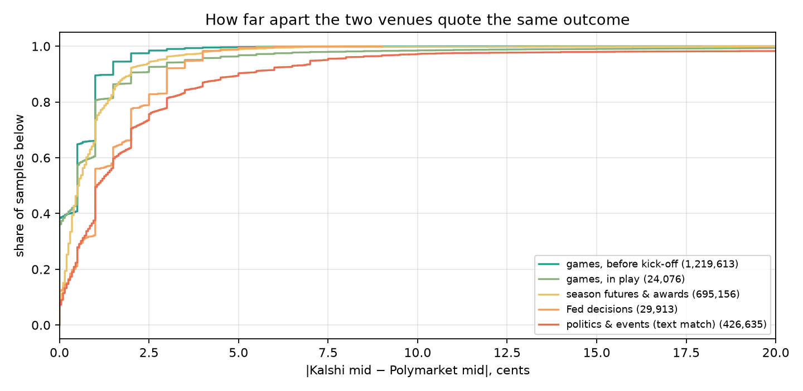
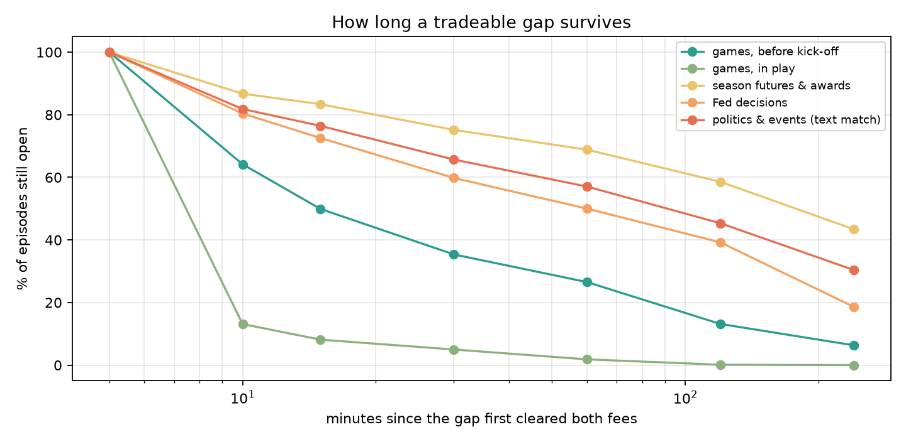
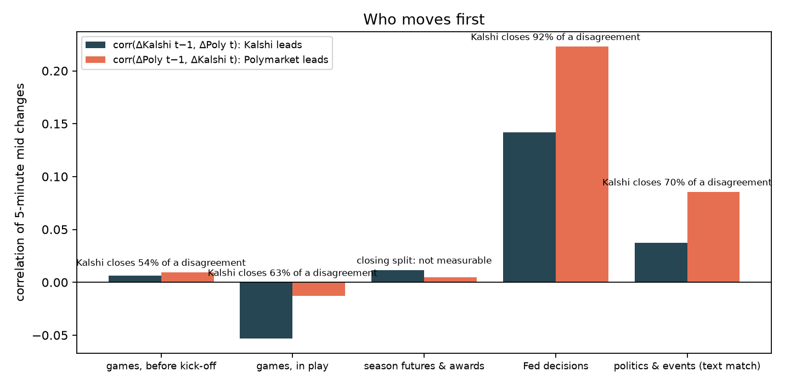
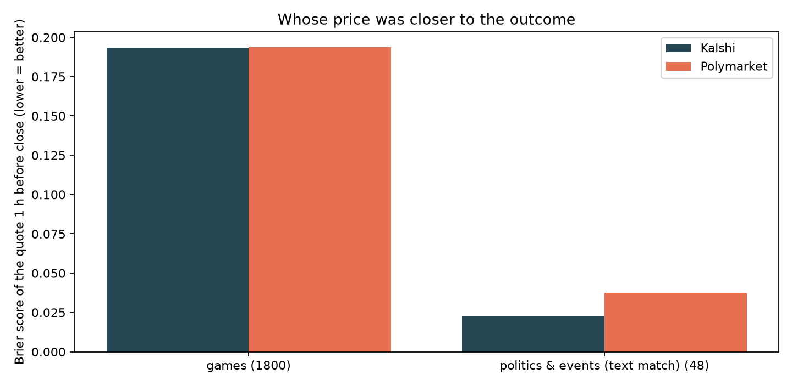

# Лаба 3 — Две площадки: один и тот же вопрос на Kalshi и Polymarket

**Статус: результаты за 19 сентября – 15 октября 2026 (26 дней).** Цены сопоставленных пар
Kalshi ↔ Polymarket снимались каждые 5 минут; здесь пайплайн, правила сопоставления и анализ:
насколько площадки расходятся, был ли разрыв когда-нибудь торгуемым после комиссий, сколько он
живёт, кто двигается первым и чья цена оказалась ближе к исходу. English: [README.md](README.md).

## Вопрос

Две площадки торгуют один исход: матч, чемпиона сезона, решение ФРС, сенатскую гонку. Как часто
их цены расходятся, на сколько, надолго ли, и какая сторона двигается первой? Устойчивый разрыв
— это либо арбитраж, который никто не может взять (Kalshi требует KYC и работает только для США,
Polymarket закрыт для американцев), либо бесплатный прогнозный сигнал для того, кто торгует одну
из сторон.

## Пайплайн

| Шаг | Скрипт | Что делает |
|---|---|---|
| 1 | `fetch.py` | Снимок открытых рынков. Kalshi: `/markets?status=open&min_close_ts=now&mve_filter=exclude` по курсору (без фильтра парлеев листинг — это 200k+ ног парлеев, а дневные матчи так и не приходят), плюс явно перечисленные серии матчей, названия событий из `/events`. Polymarket: активные рынки Gamma по объёму за 24 ч (потолок offset ~2000) плюс листинг спортивных moneyline, с исходами и id токенов CLOB. |
| 2 | `match.py` | Три матчера по очереди (рынок, взятый предыдущим, следующему не предлагается): **матчи** (та же лига, дата игры в пределах суток, обе команды совпадают — лиги США через таблицу кодов и прозвищ в `teams.py`, футбол и колледжи через токены названий клубов; каждый рынок Kalshi «команда / ничья» привязан к одному исходу Polymarket), **группы** (шаблонные серии: чемпионы сезона, корзины решения ФРС, номинанты, MVP, «Оскар» — сущности извлекаются с обеих сторон, точное совпадение для команд и корзин ФРС, иначе токены имён с правилом взаимного лучшего), **текст** (Жаккар по токенам заголовков без дат, грубый стемминг и синонимы; числа и слова-дискриминаторы вроде *vice*, *emergency*, *ticket* должны совпадать; дедлайны из формулировки должны совпадать; взаимный лучший; score ≥ 0.6). |
| 3 | `collect.py` | Каждые 5 мин: Kalshi `/markets?tickers=…` (300 за вызов) и CLOB Polymarket `POST /prices` (150 токенов за вызов) по всем активным парам → SQLite `ticks`. Каждые 6 ч заново прогоняет шаги 1–2 и обновляет список пар (появляются новые матчи, закрытые рынки снимаются). Крутится как маленький контейнер (`deploy/`). |

Предохранители в матчере: пара, у которой два мида расходятся больше чем на 35¢ в момент
сопоставления, помечается `suspect` и не собирается (неверная пара выглядит ровно как огромный
арбитраж); `pairs_manual.csv` принимает или отклоняет конкретные пары вручную и сильнее всего
остального; `--verify` перепроверяет текстовые пары через Claude, если есть ключ API.

## Покрытие на первом прогоне (19 сентября 2026)

Снимок: 137 631 открытый рынок Kalshi (без парлеев) × 3 800 активных рынков Polymarket.
676 кандидатов, оставлено 673 (2 помечены suspect, 3 отклонены вручную: футбольный матч в игре с
разрывом 39¢, «посетит Венесуэлу» против «возглавит Венесуэлу», «импичмент» против «отставка»).

| Ветка | Пар | Что внутри |
|---|---|---|
| Дневные матчи | 488 | Студенческий футбол 198, MLB 58, MLS 43, NFL 36, NHL 24, АПЛ 24, Серия A 24, Лига 1 24, Ла Лига 21, Бундеслига 18, WNBA 18 (лиги США как исходы moneyline, футбол как рынки «команда» + «ничья») |
| Шаблонные серии | 125 | Чемпион NFL 23, Мировая серия 14, Лига чемпионов 14, президент США 2028 9, «Золотой мяч» 9, чемпион АПЛ 8, кандидат демократов 8, президент Бразилии 7, чемпион NBA 7, решения ФРС (окт/дек) 6, F1 5, кандидат республиканцев 4, NHL 3, Бундеслига 3, WNBA 3, чемпион NFC 1, Ла Лига 1 |
| Свободный текст | 60 | Сенатские гонки 2026 по партиям, кандидаты на выборах президента Франции 2027, земельные выборы в Берлине и Мекленбурге, следующий премьер Израиля, места в первом туре в Бразилии, рынки с дедлайном Трамп / Си / Мерц, Нобелевская премия мира |

**Где крутится.** API Kalshi отвечает 403 (CloudFront) серверу проекта, который стоит в регионе,
закрытом для Kalshi; Polymarket отвечает нормально. Контейнер из `deploy/` поэтому собран, но
остановлен, а коллектор пока крутится на ноутбуке — отсюда дыры, когда он спит. Хост в незакрытом
регионе это решает; в коде ничего не меняется.

## Результаты (19 сентября – 15 октября 2026)

Данные: 26.1 дня, 4 443 пятиминутных цикла, 4.88 млн замеров по 2 447 парам (1 859 рынков матчей,
356 фьючерсов сезона и наград, 9 корзин ФРС, 194 текстовые пары по политике и событиям); 2 036
рынков Kalshi закрылись внутри окна. Замер считается, только когда обе площадки котируют со спредом
не шире 10¢: это 49% всех замеров (65% замеров матчей до начала игры, 3% в игре, 48% фьючерсов,
63% политики). У Kalshi нет пригодной котировки в 49% замеров, у Polymarket в 32%; главная потеря
данных — тонкие стаканы Kalshi, а не сопоставление. Все цифры ниже из `results.json`, полные
таблицы в `tables.md`.

### 1. Площадки сходятся в пределах цента, кроме политики

| Категория | Пар | Замеров | Медиана \|разрыва\| | p90 | > 5¢ | > 10¢ |
|---|---|---|---|---|---|---|
| Матчи, до начала | 1 823 | 1.22 млн | 0.5¢ | 1.5¢ | 0.3% | 0.1% |
| Матчи, в игре | 1 088 | 24 тыс. | 0.5¢ | 2.0¢ | 3.5% | 1.5% |
| Фьючерсы сезона и награды | 220 | 695 тыс. | 0.55¢ | 2.0¢ | 1.2% | 0.2% |
| Решения ФРС | 8 | 30 тыс. | 1.0¢ | 3.0¢ | 0.8% | 0.0% |
| Политика и события (текст) | 170 | 426 тыс. | 1.05¢ | 5.0¢ | 10.2% | 2.8% |



Средний разрыв со знаком (Kalshi минус Polymarket): −0.02¢ на матчах, +0.15¢ на фьючерсах,
+0.23¢ на политике — систематической премии нет ни у одной площадки. Настоящее расхождение есть
только в политике, и там 11% пар стоят в среднем дальше 5¢ друг от друга.

### 2. После комиссий арбитраж есть, но он мал, медленен и не берётся одним счётом

Схема: купить YES на той площадке, где дешевле, и NO на другой, держать до резолюции; комиссия
тейкера Kalshi 7% × p(1−p) на контракт, у Polymarket — собственное расписание рынка из Gamma
(4–5% × p(1−p), где комиссии включены, ноль, где выключены). Мейкеры не платят ни там, ни там,
так что терпеливый ордер может выйти лучше этих тейкерских цифр.

| Категория | Стаканы пересеклись | Нетто > 0 после комиссий | Нетто > 1¢ | Медиана нетто, когда > 0 | p90 | Пар с нетто > 0 хоть раз | Комиссии за круг, медиана |
|---|---|---|---|---|---|---|---|
| Матчи, до начала | 2.3% | 0.39% | 0.12% | 0.33¢ | 6.1¢ | 9% | 1.9¢ |
| Матчи, в игре | 9.3% | 5.5% | 3.6% | 1.8¢ | 17.9¢ | 40% | 1.4¢ |
| Фьючерсы сезона и награды | 50.6% | 36.0% | 6.7% | 0.28¢ | 1.5¢ | 83% | 0.31¢ |
| Решения ФРС | 28.9% | 7.9% | 0.6% | 0.6¢ | 0.8¢ | 100% (8) | 2.3¢ |
| Политика и события | 45.8% | 27.2% | 13.5% | 0.99¢ | 6.5¢ | 92% | 1.15¢ |

На матчах стаканы пересекаются в 2% замеров и перекрывают обе комиссии в 0.4%. На фьючерсах
пересечена половина замеров, но это контракты по 2–10¢, где комиссии треть цента, а край —
четверть цента на акцию, замороженную до конца сезона. Политика — единственное место, где цент
и больше встречается в 13.5% замеров. Ничто из этого не сделка для одного счёта: Kalshi только
для США и с KYC, Polymarket блокирует американцев, так что две ноги живут на счетах двух разных
людей, и капитал на обоих заморожен до резолюции. Разрыв — прогнозный сигнал, а не доход.

### 3. Сколько живёт разрыв

| Категория | Минут на пару-день с нетто > 0 | Медиана эпизода | p75 | ≥ 15 мин | ≥ 60 мин | Полураспад разрыва мидов |
|---|---|---|---|---|---|---|
| Матчи, до начала | 2.6 | 15 мин | 65 мин | 50% | 27% | 106 мин |
| Матчи, в игре | 5.5 | 5 мин | 5 мин | 8% | 2% | 13 мин |
| Фьючерсы сезона и награды | 261 | 171 мин | 360 мин | 83% | 69% | 17 ч |
| Решения ФРС | 59 | 58 мин | 194 мин | 73% | 50% | 4 ч |
| Политика и события | 192 | 80 мин | 295 мин | 76% | 57% | 34 ч |



Это не гонка на скорость. Разрыв, перекрывающий комиссии на политическом рынке, живёт 80 минут по
медиане и в 57% случаев ещё открыт через час; само расхождение мидов вне матчей затухает с
полураспадом в сутки и больше. Эти разрывы никто не закрывает не потому, что они исчезают, а потому,
что никто не может (см. выше). Длительности обрезаны паузами самого коллектора (пересопоставление
раз в 6 часов и сон ноутбука, в среднем 5 пауз в день), так что длинный хвост цензурирован около
6 часов; колонка «минут в день» от этого не зависит.

### 4. Кто двигается первым

Кросс-корреляция пятиминутных изменений мида и разложение по коррекции ошибки: если площадки
расходятся в момент *t*, какую часть следующего пятиминутного шага навстречу делает каждая сторона.
Интервалы — 95%-й бутстреп по парам.

| Категория | Тот же интервал | Kalshi ведёт (лаг 1) | Polymarket ведёт (лаг 1) | Доля расхождения, которую закрывает Kalshi |
|---|---|---|---|---|
| Матчи, до начала | 0.40 | 0.006 [−0.03; 0.05] | 0.010 [−0.02; 0.05] | 55% [41; 65] |
| Фьючерсы сезона и награды | 0.22 | 0.012 [−0.04; 0.05] | 0.005 [−0.07; 0.07] | не измеряется: Polymarket к Kalshi не двигается вовсе (β = −0.0004 [−0.0016; 0.0017]), Kalshi дрейфует к Polymarket (+0.0017 [0.0008; 0.0053]) |
| Решения ФРС | 0.51 | 0.14 [0.01; 0.19] | 0.22 [0.01; 0.30] | 92% [83; 100] (8 пар) |
| Политика и события | 0.33 | 0.037 [0.005; 0.068] | 0.086 [0.048; 0.123] | 70% [60; 81] |



Матчи двигаются вместе внутри пятиминутного окна, и никто не ведёт. В политике первым двигается
Polymarket: его последний шаг предсказывает следующий шаг Kalshi вдвое сильнее, чем наоборот, а
когда площадки расходятся, 70% шага навстречу делает Kalshi. Корзины ФРС показывают то же на 8
парах. На фьючерсах разрыв закрывается только со стороны Kalshi, медленно. Матчи в игре на
пятиминутном разрешении читать нельзя (отскок bid-ask даёт отрицательные корреляции по лагу), они
исключены.

### 5. Кто оказался прав

**Проверка резолюции.** 2 035 пар закрылись на обеих площадках; 22 (1.1%) закрылись по-разному, а
это значит, что пара была неверной, а не что арбитраж выплатился: 12 из 1 883 матчей (шесть матчей
MLB привязаны к игре соседнего дня той же серии, оба исхода зеркально), 10 из 119 текстовых пар
(восемь рынков «максимальная температура» привязаны к предыдущему дню, одна «не меньше 8%» к
«меньше 8%», одна «победит» к «займёт второе место»), 0 из 33 фьючерсов. Эти 22 пары дали 0.03%
замеров по политике, так что цифры разрывов выше не из них; правки матчера перечислены ниже. Среди
ещё не закрывшихся текстовых пар, вероятно, похожая доля тоже неверна.

**Калибровка.** По 1 868 верно сопоставленным рынкам с годной котировкой не позже чем за час до
начала матча (матчи) или закрытия на Kalshi (остальные):

| | Пар | Brier Kalshi | Brier Polymarket | Разница, Kalshi − Polymarket |
|---|---|---|---|---|
| Все | 1 868 | 0.1870 | 0.1878 | −0.0007 [−0.0014; −0.0002] |
| Матчи | 1 800 | 0.1934 | 0.1938 | −0.0004 [−0.0009; +0.0001] |
| Политика и события | 48 | 0.023 | 0.037 | −0.0145 [−0.030; −0.002] |



На матчах площадки одинаково хороши до четвёртого знака. На 48 закрывшихся политических рынках
цена Kalshi за час до закрытия была ближе к исходу: Polymarket держал несколько центов на исходах,
которые уже были решены — та же премия дешёвых исходов, что в лабе 1, только с другой стороны.
Лишь 8 пар расходились больше чем на 5¢ в опорный момент — слишком мало, чтобы сказать, кто прав,
когда площадки расходятся по-настоящему; на этот вопрос нужны месяцы, а не недели.

## Что это значит

- «Арбитраж между Kalshi и Polymarket» из форумных постов — это на матчах пересечённый стакан в 2%
  замеров, который перекрывает комиссии в 0.4% и живёт минуты. В политике это около цента, живёт
  часами и существует потому, что ни один счёт не может торговать обе площадки.
- Ежедневный пост с разрывами в канале читать соответственно: 1–2¢ на матче — шум; несколько центов
  на политическом рынке — медленное расхождение, в котором Polymarket обычно уже сдвинулся первым, а
  Kalshi обычно та сторона, которая сдвинется.
- Для движка: межплощадочный разрыв — это признак для стратегии на стороне Kalshi (шаг Polymarket —
  сигнал на час вперёд по политике), а не для арбитражной стратегии.

## Оговорки

- Только верх стакана, размер не записывался: исполнимый разрыв на один контракт может не существовать
  на сто.
- Пятиминутная выборка. Всё более быстрое, включая почти всю игру в реальном времени, невидимо;
  строки «в игре» приведены для полноты.
- Комиссии: расписание Kalshi 7% относится к большинству серий (у некоторых индексных рынков ниже);
  округление до цента не учтено; расписание Polymarket берётся по рынку из Gamma, 4% там, где его нет.
- Пары выбраны нашим матчером: 8% закрывшихся текстовых пар оказались неверными, а пары с
  расхождением больше 35¢ в момент сопоставления исключены как suspect, так что самые широкие
  расхождения вне выборки по построению.
- 26 дней на одном ноутбуке: три дня с меньше чем 100 тыс. замеров, потому что машина спала;
  длительности эпизодов цензурированы паузами коллектора.

## Правки матчера в очереди

- Текстовые пары: если в обоих заголовках есть календарная дата, требовать один и тот же день
  (рынки температуры); добавить слова направления (*less / under / below* против *at least / more /
  over*) и *runner-up* в дискриминаторы, которые обязаны совпадать.
- Матчи: пары MLB сопоставлять по времени начала в пределах двух часов, а не суток, чтобы серии из
  подряд идущих игр и дабл-хедеры не пересекались.

## Файлы

- `teams.py` — таблицы псевдонимов команд (NFL, MLB, NBA, NHL) и нормализация названий клубов.
- `fetch.py`, `match.py`, `collect.py` — пайплайн; `pairs_manual.csv` — ручные правки.
- `settle.py` — метаданные резолюции и комиссий по каждой паре (результат Kalshi, цены исходов и
  расписание комиссий Polymarket) → `data/labs/xvenue/meta.json`.
- `analyze.py` — анализ выше → `results.json`, `tables.md`, `figures/`.
- `deploy/Dockerfile`, `deploy/docker-compose.yml` — контейнер коллектора.
- Данные: `xvenue.db.gz` (SQLite коллектора, 26 дней тиков) и `meta.json` лежат в релизе
  `data-latest` этого репо; `pairs.parquet` — текущий список пар.

## Воспроизвести

```bash
python3 -m venv .venv && source .venv/bin/activate && pip install -r requirements.txt -r requirements-labs.txt
gh release download data-latest -p xvenue.db.gz -p meta.json -D data/labs/xvenue && gunzip data/labs/xvenue/xvenue.db.gz
python3 labs/2026-10-01-cross-venue/settle.py --db data/labs/xvenue/xvenue.db     # обновляет meta.json по парам, закрывшимся с тех пор
python3 labs/2026-10-01-cross-venue/analyze.py --db data/labs/xvenue/xvenue.db    # ~4 мин: results.json, tables.md, figures/
```
